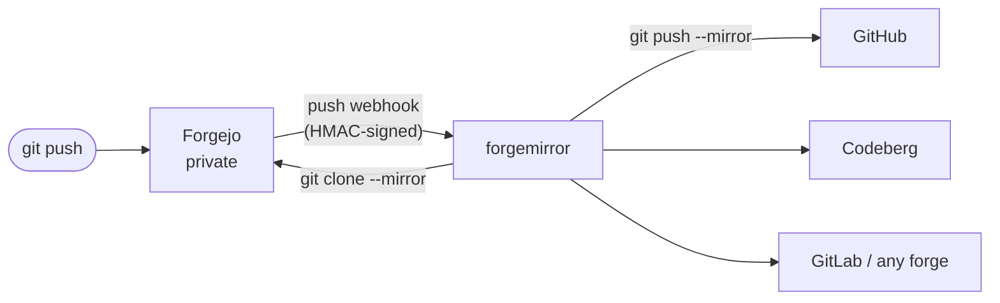

<div align="center">

# forgemirror

**Your Forgejo stays private. Your code goes public, instantly.**

forgemirror listens for Forgejo push webhooks and mirrors the repository to
GitHub, Codeberg, GitLab or any other Git forge within seconds.

[](https://forgemirror.bitfoo.de)
[](go.mod)
[](LICENSE)
[](#verify-a-release)

[Documentation](https://forgemirror.bitfoo.de) ·
[Getting started](https://forgemirror.bitfoo.de/docs/getting-started/) ·
[Configuration](https://forgemirror.bitfoo.de/docs/configuration/) ·
[Changelog](CHANGELOG.md)

</div>

## How it works



Forgejo only has to reach forgemirror, and forgemirror only connects
outward, so the Forgejo instance never needs to be reachable from the
internet. Every push leads to one clone and parallel pushes to all targets.

## Features

- ⚡ **Push-driven:** no polling and no cron. Pushes that arrive during a run
  are coalesced into one follow-up run.
- 🧩 **One target, many repositories:** target URLs are Go templates, so
  `https://codeberg.org/{{ .Owner }}/{{ .Name }}.git` covers every repository.
- 🏗️ **Creates and syncs repositories:** typed targets (GitHub, GitLab,
  Forgejo) create missing repositories and keep description, topics, default
  branch, visibility, issues/wiki/pull requests and labels in line, with
  per-target defaults and per-repository overrides. A private repository
  never becomes public.
- ⏱️ **Scheduled sync:** run on an interval instead of, or besides, push
  webhooks; unchanged repositories are skipped. Optionally delete a mirror
  when its Forgejo repository is deleted.
- 🎯 **Filters:** include or exclude repositories by pattern, restrict
  branches, skip private repositories and forks, or opt in per repository
  with a topic.
- 🔒 **Secrets stay secret:** tokens never touch disk, process arguments or
  logs. Each token is sent only to its own remote, and `source.base_url` pins
  clone URLs to your Forgejo.
- 🔍 **Review before publishing:** every run first computes what it would
  change, and the logs record every ref, setting and label it changed. With
  `sync.auto: false` nothing is pushed until you press *Sync* in the web UI.
- 🖥️ **Web UI:** an optional status page shows every repository with its
  diff per target, recent logs and the effective configuration, in Tokyo
  Night light and dark. It runs on its own port, ready for your proxy or SSO.
- 📈 **Ready to operate:** Prometheus metrics, structured logs, health probes
  on a separate port, graceful shutdown, a Helm chart and signed multi-arch
  images.

## Quick start

**1. Write `forgemirror.yaml`:**

```yaml
webhook:
  secret: a-long-random-string        # openssl rand -hex 32
source:
  base_url: https://git.example.org/  # your Forgejo
targets:
  - name: codeberg
    url: "https://codeberg.org/{{ .Owner }}/{{ .Name }}.git"
    token: your-codeberg-token
```

**2. Run it:**

```sh
docker run --rm -p 8081:8081 \
  -v "$PWD/forgemirror.yaml:/etc/forgemirror/forgemirror.yaml:ro" \
  git.bitfoo.de/dvonessen/forgemirror:latest \
  --config /etc/forgemirror/forgemirror.yaml
```

**3. Point Forgejo at it:** add a webhook of type *Forgejo* with target URL
`http://<forgemirror-host>:8081/webhook`, content type `application/json`, the
secret from step 1, and push events. Then push.

Target repositories must already exist, unless the target has a `type` and
`create: true`. For every option, see
[`forgemirror.example.yaml`](forgemirror.example.yaml) and the
[configuration docs](https://forgemirror.bitfoo.de/docs/configuration/).

## Install

| Method     | Where                                                                                 |
|------------|---------------------------------------------------------------------------------------|
| Container  | `git.bitfoo.de/dvonessen/forgemirror` (linux/amd64, linux/arm64; non-root, includes git) |
| Helm chart | `oci://git.bitfoo.de/dvonessen/charts/forgemirror`, see [its README](charts/forgemirror/README.md) |
| Kustomize  | [`deploy/`](deploy/README.md)                                                          |
| Binary     | [Releases](https://git.bitfoo.de/dvonessen/forgemirror/releases) for linux and darwin, amd64 and arm64 |

## Verify a release

The checksum file (covering all binaries), the images and the charts are
signed with cosign; the public key is
[`cosign.pub`](cosign.pub). Every release also ships SBOMs.

```sh
cosign verify-blob --key cosign.pub \
  --bundle checksums.txt.sigstore.json checksums.txt
sha256sum --check --ignore-missing checksums.txt

cosign verify --key cosign.pub git.bitfoo.de/dvonessen/forgemirror:<version>
```

## Development

[mise](https://mise.jdx.dev) installs every tool and runs every task; CI and
the git hooks call the same tasks.

```sh
mise install            # pinned Go, linters, Hugo, …
mise run check          # the full gate: lint, tests (≥ 80 % coverage), vuln scan, manifests, docs
mise run docs:serve     # preview the documentation
```

Commits follow [Conventional Commits](https://www.conventionalcommits.org) with
gitmoji (`feat(webhook): :sparkles: …`). Releases are cut by merging the
bot's release PR; see [CI/CD and releases](https://forgemirror.bitfoo.de/docs/development/ci-cd/).

## License

[MIT](LICENSE)
