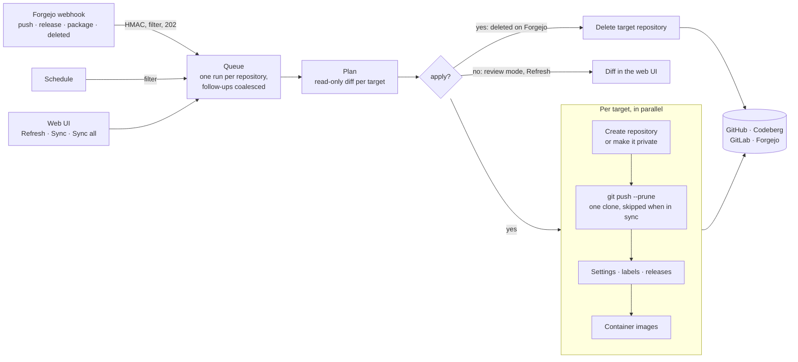

ForgeMirror is a small Go service. It mirrors repositories from a Forgejo
instance to one or more public forges: on every push, on a schedule, or when
you press *Sync* in the web UI. Besides branches and tags it can create the
target repository and keep its settings, labels, releases and container images
in line. Your Forgejo instance can stay private: the only connection it needs
is the outgoing webhook to ForgeMirror, and with a schedule not even that.

## How it works

1. **Trigger.** A run starts for one repository when Forgejo sends a signed
   push, release or package webhook, or a repository deletion. A
   [schedule](configuration/#sync) starts runs for every repository, and the
   [web UI](web-ui/) starts them on demand. Webhooks are verified (HMAC) and
   checked against the [filter rules](configuration/#filter); ForgeMirror
   answers immediately, and the run happens in the background.
2. **Plan.** Every run first computes what a sync would change on each
   target, without changing anything: branches and tags (`git ls-remote`),
   and on [typed targets](configuration/#typed-targets) the repository,
   settings, labels, releases and container images via the forge APIs.
3. **Review or apply.** In [review mode](web-ui/#review-mode)
   (`sync.auto: false`), and whenever you press *Refresh*, the plan is only
   shown as a diff in the web UI until you press *Sync*. Otherwise it is
   applied right away.
4. **Apply.** Per target, in parallel: create the repository if it is missing
   (`create: true`) or make a public one private (`private: true`), push all
   branches and tags with `--prune` from a single clone, then update
   settings, labels and releases and copy container images. Targets that are already in sync get no push; when all are, the
   clone is skipped too. A repository deleted on Forgejo is deleted on the
   targets that set `delete: true`.
5. **Coalesce.** Events that arrive while a repository is being mirrored are
   coalesced into exactly one follow-up run. That run mirrors the latest
   state, so no push is lost and no work is repeated.

## Where to go next


  
  
  
  
  
  
  
  

