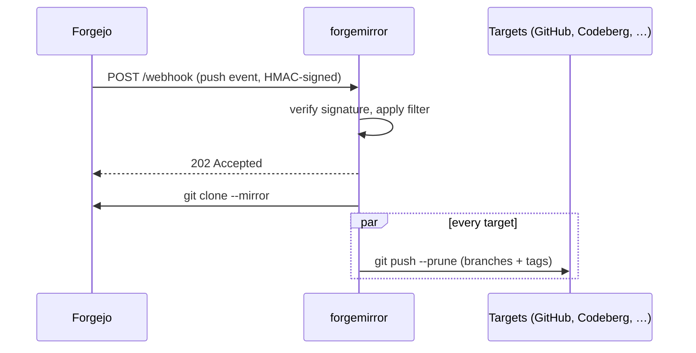

forgemirror is a small Go service. It receives Forgejo push webhooks and
mirrors the pushed repository to one or more public forges. Your Forgejo
instance can stay private: the only connection it needs is the outgoing
webhook to forgemirror.

## How it works

1. A push to Forgejo sends a signed webhook to forgemirror.
2. forgemirror verifies the HMAC signature and checks the [filter
   rules](configuration/#filter). It answers immediately, and mirroring runs
   in the background.
3. It clones the repository once into a temporary directory and pushes all
   branches and tags to every target in parallel. Branches and tags that were
   deleted on Forgejo are deleted on the targets as well.
4. Pushes that arrive while a repository is being mirrored are coalesced into
   exactly one follow-up run. That run mirrors the latest state, so no push is
   lost and no work is repeated.

## Where to go next


  
  
  
  
  
  
  

