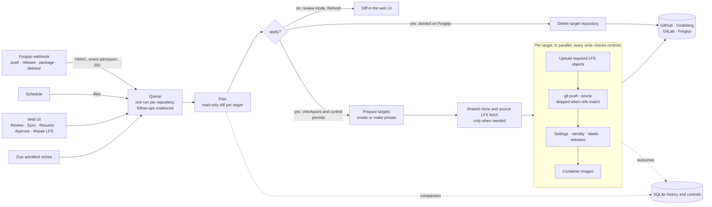

ForgeMirror is a small Go service. It mirrors repositories from a Forgejo
instance to one or more public forges: on every push, on a schedule, or when
you explicitly authorize publication in the web UI. Besides branches, tags
and Git LFS objects it can create the target repository and keep settings,
labels, public mirror identity, releases and container images in line. Your Forgejo instance can stay private: the only connection it needs
is the outgoing webhook to ForgeMirror, and with a schedule not even that.

The mandatory SQLite database retains history, pauses, retry intent,
destination grants and notification outboxes. Per-target explanations show
why work is held and what happens next. Optional first-publication approval
and outbound notifications are configured in [Configuration](configuration/);
provider token setup has its own [permission tables](configuration/#token-permissions).

## How it works

1. **Trigger.** A run starts for one repository when Forgejo sends a signed
   push, release or package webhook, or a repository deletion. A
   [schedule](configuration/#sync) starts runs for every repository, and the
   [web UI](web-ui/) starts them on demand. Webhooks are verified (HMAC) and
   admitted according to event type and [filter rules](configuration/#filter);
   deletion events bypass ordinary push filters. ForgeMirror answers
   immediately, and work happens in the background.
2. **Plan.** Every run first computes what a sync would change on each
   target, without changing anything: branches and tags (`git ls-remote`),
   and on [typed targets](configuration/#typed-targets) the repository,
   settings, labels, releases and container images via the forge APIs.
3. **Review or apply.** In [review mode](web-ui/#review-mode)
   (`sync.auto: false`), and whenever you press *Refresh*, the plan is only
   shown as a diff. Sync, resume, approval-and-sync and object-only repair are
   explicit write authorizations. Automatic applies and authorized retries
   still obey pause, destination approval and durable checkpoint requirements.
4. **Apply.** Prepare permitted targets, then download required source LFS
   objects once. Per destination, upload objects before pushing branches/tags
   with `--prune`, then update metadata and artifacts. Matching refs skip the
   push and normal clone; explicit LFS repair reconciles objects separately.
   Source or destination transfer failures are held back and classified for
   bounded retries. [Deletion policy](configuration/#typed-targets) is opt-in
   and still obeys pauses.
5. **Coalesce.** Events that arrive while a repository is being mirrored are
   coalesced into exactly one follow-up run. That run mirrors the latest
   state without concurrent duplicate runs. Durable retries re-plan and skip
   completed work; history is evidence, not an executable saved plan.
6. **Observe.** Browse retained sync attempts, per-target publication reasons,
   next actions and LFS evidence. Optional notifications use an independently
   retried, transition-deduplicated outbox; notification failures do not undo or
   prevent publication.

## Where to go next


  
  
  
  
  
  
  
  

